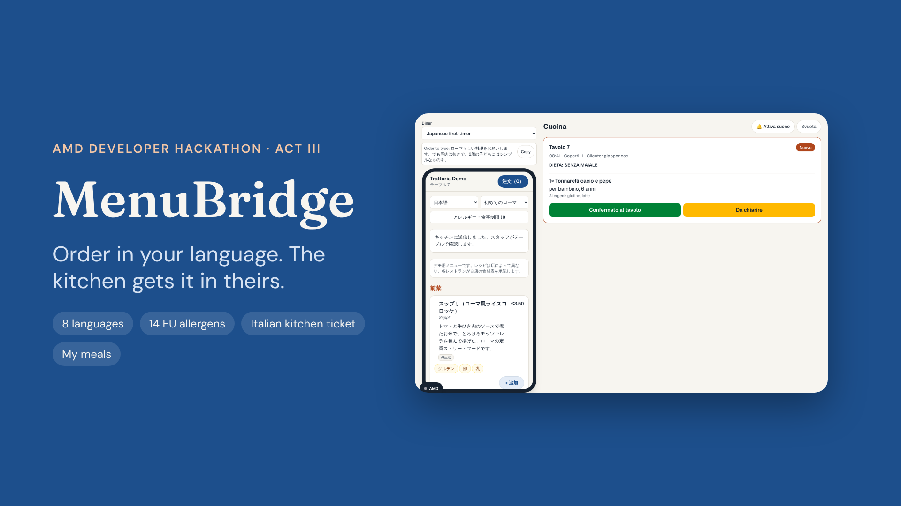
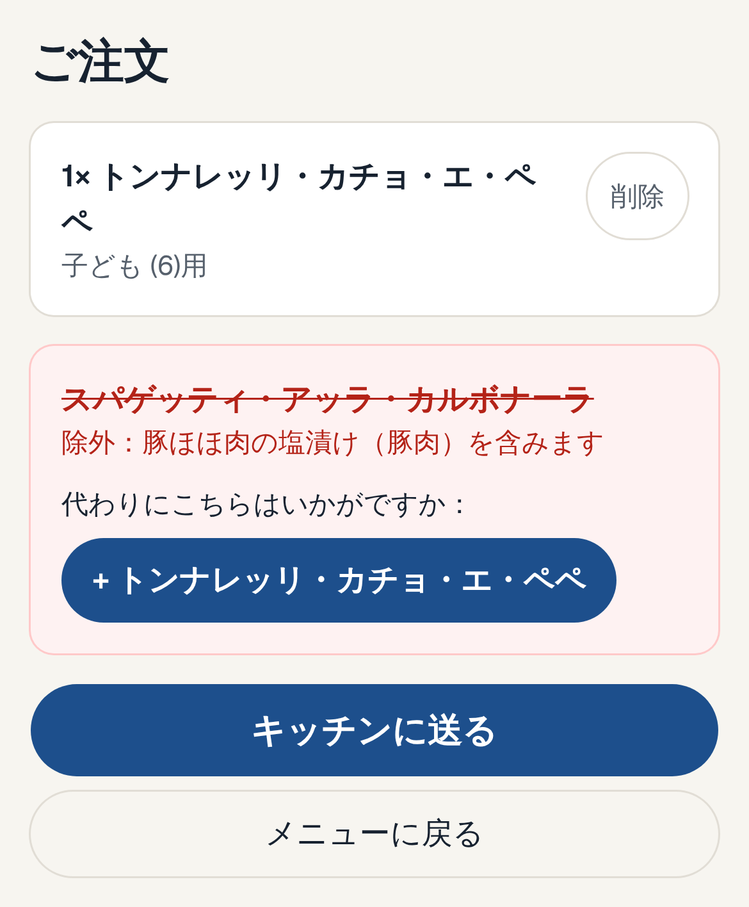
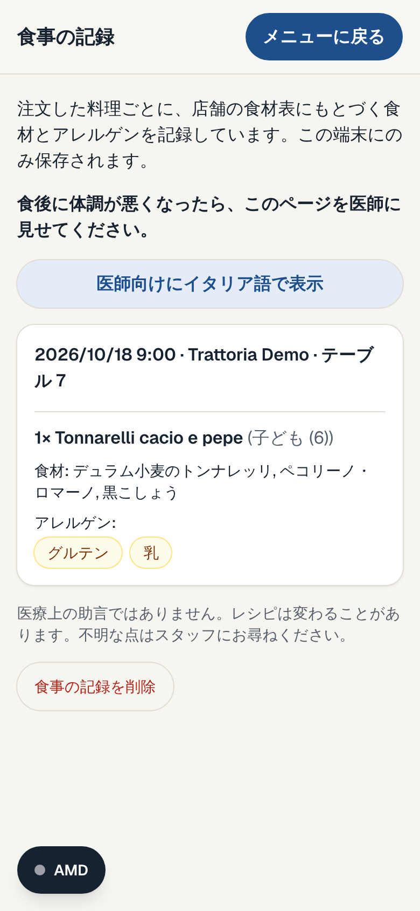
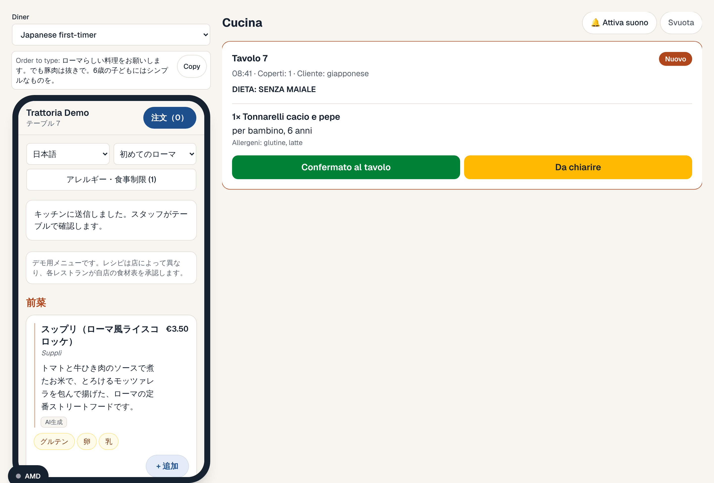
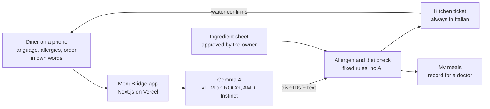

<div align="center">



# MenuBridge

**Order in your language. The kitchen gets it in theirs.**

A QR menu that rewrites itself for every diner, takes the order in their own words,<br>
blocks anything that clashes with their allergies, and sends the kitchen a ticket in Italian.

[**Try the live demo**](https://menubridge-nine.vercel.app/demo) · [How it works](#how-it-works) · [Run it locally](#run-it-locally)

[](https://menubridge-nine.vercel.app)
[](#amd-under-the-hood)
[](#amd-under-the-hood)
[](https://nextjs.org)
[](tsconfig.json)
[](LICENSE)

</div>

---

## Why

Rome had **22.9 million** tourist arrivals in 2025. Most of them can't read an Italian menu, and anyone with a food allergy or coeliac disease has to trust a rushed translation or a busy waiter. A translated menu still doesn't say what *cacio e pepe* is, and it can't promise anything about allergens.

MenuBridge fixes the whole table, not just the words:

| | |
|---|---|
| 🌍 **A menu written for you** | 8 languages and 4 kinds of diner: a first-timer learns what a dish is and how to eat it; a food lover gets origin and technique. |
| 🗣️ **Order in your own words** | Typed or spoken: *"something Roman, no pork, and something simple for my 6-year-old"*. |
| 🛡️ **Allergies checked by rules, not by AI** | 14 EU allergens and diets, computed from the restaurant's owner-approved ingredient sheet. Clashing dishes are removed with the reason in your language, plus safe alternatives. |
| 🇮🇹 **A clean Italian kitchen ticket** | Diet line, allergens, who each dish is for. A waiter confirms it at the table and the diner's phone updates. |
| 📋 **My meals** | A private record on the phone of every dish, ingredient and allergen, switchable to Italian, so a diner who feels unwell can show a doctor exactly what they ate. |

## See it

<table>
<tr>
<td width="25%" align="center"><br><sub><b>The menu, in Japanese</b><br>written for a first-timer</sub></td>
<td width="25%" align="center"><br><sub><b>The safety check</b><br>carbonara removed: it contains pork</sub></td>
<td width="25%" align="center"><br><sub><b>My meals</b><br>a record to show a doctor</sub></td>
<td width="25%" align="center"><br><sub><b>Scan to try</b><br>table 7 of the demo trattoria</sub></td>
</tr>
</table>



<sub>The phone and the kitchen side by side at <code>/demo</code>: the order typed in Japanese arrives as an Italian ticket.</sub>

## Try it

| Page | What you'll see |
|---|---|
| [`/demo`](https://menubridge-nine.vercel.app/demo) | Phone and kitchen side by side, with four ready-made diners |
| [Japanese first-timer](https://menubridge-nine.vercel.app/m/demo-trattoria?lang=ja&aud=first_timer&table=7) | The menu rewritten in Japanese; order *"something Roman, no pork"* |
| [Fish allergy](https://menubridge-nine.vercel.app/m/demo-trattoria?lang=en&aud=dietary&allergens=fish) | Puntarelle and anything else with fish removed, with the reason |
| [`/kitchen`](https://menubridge-nine.vercel.app/kitchen) | The Italian kitchen board, open it next to the menu in the same browser |
| [`/m/demo-trattoria/meals`](https://menubridge-nine.vercel.app/m/demo-trattoria/meals) | My meals, after you have sent an order |
| [`/metrics`](https://menubridge-nine.vercel.app/metrics) | The AMD panel: model, latency, tokens/s and cost of every call |
| [`/about`](https://menubridge-nine.vercel.app/about) | How it works and the track compliance statement |

> [!NOTE]
> The public demo runs on saved answers (`MOCK_LLM=1`), and the AMD panel marks every call `mock`. Everything else in the flow is the real app: the allergen and diet check, the kitchen ticket, the waiter confirmation and My meals. See [AMD under the hood](#amd-under-the-hood) for the model status.

## How it works



### The AI writes. Rules decide.

| Gemma 4 does | It never decides |
|---|---|
| Explains every dish in 8 languages for 4 audiences | Which allergens a dish contains |
| Maps free text like *"something Roman, no pork"* to real dish IDs | Whether a dish fits a diet |
| Translates diners' notes into Italian for the kitchen | Whether a dish is safe |
| Drafts a new restaurant's ingredient sheet for the owner to approve | What reaches the kitchen |

**Safety by design**

- **Deterministic gate.** `lib/gate.ts` computes allergens and diets from the menu JSON and checks every line again before a ticket is built.
- **Closed world.** The model can only name dish and ingredient IDs that exist: JSON-schema enums in the request, plus a server-side check that drops anything else.
- **Validated output.** Every model answer is validated with zod, retried once with the error, then replaced by a safe deterministic fallback; the UI never crashes on bad output.
- **Claim guard.** Words like "gluten-free" or "safe for" are rejected in all 8 languages.
- **Owner approval.** A dish the owner hasn't approved shows "Ask staff about allergens" and never passes for a diner with any allergy or diet.
- **Labelled AI.** Every AI-written text carries an "AI-generated" label; a waiter confirms every ticket at the table.

## AMD under the hood

| | |
|---|---|
| **Model** | `google/gemma-4-26B-A4B-it`: a mixture of experts with about 4B active parameters, fast and small enough for one GPU |
| **Serving** | vLLM on ROCm (`vllm/vllm-openai-rocm:gemma4`) on one AMD Instinct MI300X (192 GB), OpenAI-compatible API with JSON-schema constrained output |
| **Switching backends** | Three environment variables: `LLM_BASE_URL`, `LLM_API_KEY`, `LLM_MODEL` (vLLM on AMD Developer Cloud, or AMD Token Factory) |
| **Observability** | Every call returns model, latency, tokens, tokens/s and cost in EUR; vLLM's Prometheus metrics (running and waiting requests, KV cache, tokens) are live at `/metrics` |
| **Offline fallback** | When the GPU is off, saved answers are served with the banner *"GPU offline - showing results generated earlier on AMD Instinct MI300X"* |

**Status.** The MI300X server was not set up in time for the hackathon. The first live calls ran on **AMD Token Factory** with `Gemma-4-31B-IT` through the app's own code (`npm run llm-check`), but the shared endpoint answered at about 6 tokens/s with few parallel requests allowed, too slow for a live demo. The benchmark below is ready to run.

**Benchmark** (`npm run bench`, realistic MenuBridge requests at 1, 8, 32 and 64 concurrent requests):

<!-- bench:start -->
Not run yet. `npm run bench` against the droplet writes this table, `bench/results.json` and `bench/results.md`.
<!-- bench:end -->

## Run it locally

Mock mode needs no GPU and no keys:

```bash
npm install && cp .env.example .env.local
npm run dev        # http://localhost:3000, MOCK_LLM=1
```

Against a real model: in `.env.local` set `MOCK_LLM=0`, `LLM_BASE_URL`, `LLM_API_KEY` and `LLM_MODEL`, then check it with `npm run llm-check`. With Docker: `cp .env.example .env && docker compose up --build`.

<details>
<summary><b>Commands</b></summary>

| Command | What it does |
|---|---|
| `npm run dev` | Development server |
| `npm test` | Unit tests (vitest), including the allergen gate and My meals |
| `npm run lint` | ESLint, with the React Compiler rules |
| `npm run llm-check` | Checks the endpoint in `.env.local`: key format, models served, raw requests, one live menu and one live order |
| `npm run bench` | Load test of the live endpoint; writes `bench/` and the table above |
| `npm run warm-cache` | Saves the live model's answers for the demo into `data/cache` |
| `npm run smoke -- <url>` | Checks a deployment: pages, health, a menu, an order with a removal |
| `npm run screenshots -- <url>` | Retakes the QR code and the screenshots in `submission/assets` |
| `npm run check-submission` | Checks the hackathon texts in `submission/` against their limits |

No local setup? **Actions → Model tasks → Run workflow** runs `llm-check`, `warm-cache` or `bench` on GitHub with the repository secret `LLM_API_KEY`, and commits the results.

</details>

<details>
<summary><b>Environment variables</b></summary>

| Variable | Example | Meaning |
|---|---|---|
| `LLM_BASE_URL` | `http://DROPLET_IP:8000/v1` | OpenAI-compatible endpoint: vLLM on the MI300X, or AMD Token Factory |
| `LLM_API_KEY` | secret | The `--api-key` given to vLLM, or the Token Factory key |
| `LLM_MODEL` | `google/gemma-4-26B-A4B-it` | Model name the endpoint serves |
| `LLM_METRICS_URL` | `http://DROPLET_IP:8000/metrics` | vLLM Prometheus metrics for the AMD panel |
| `GPU_HOURLY_USD` | `1.99` | GPU price per hour, from the billing page |
| `EUR_PER_USD` | `0.86` | Exchange rate for costs in EUR |
| `BENCH_TOKENS_PER_SEC` | printed by `npm run bench` | Throughput at concurrency 32, used to price each call |
| `ADMIN_PASSCODE` | secret | Unlocks `/admin/import`; the page is closed when unset |
| `MOCK_LLM` | `1` | `1` = saved answers, no model needed |
| `CACHE_WRITE` | unset | Set only by `npm run warm-cache` |

</details>

<details>
<summary><b>Deploy</b></summary>

1. Start the model on an AMD Developer Cloud MI300X (vLLM with `--api-key`) and open only port 8000 in its firewall.
2. Import this repository in Vercel and set the environment variables above, with `MOCK_LLM=0`.
3. Run `npm run bench` and `npm run warm-cache` against the server, commit `bench/` and `data/cache`, and set `BENCH_TOKENS_PER_SEC`.
4. Deploy, then run `npm run smoke -- https://your-app.vercel.app`.

**Add a restaurant:** open `/admin/import`, paste its Italian menu, review the drafted ingredient sheet with the owner, download the JSON and commit it as `data/<id>.json`. The menu is then live at `/m/<id>`.

</details>

<details>
<summary><b>Project structure</b></summary>

```text
app/            pages (menu, kitchen, demo, metrics, about, admin) and API routes
components/     diner, kitchen, demo, admin and AMD panel UI
lib/            the gate, i18n (8 languages), model client, tickets, My meals
data/           menus as JSON (the owner-approved ingredient sheets) and saved answers
scripts/        llm-check, bench, warm-cache, smoke, screenshots
tests/          vitest suites
submission/     hackathon texts, slides outline and images
```

</details>

## Limitations

- **Model:** the public demo runs on saved answers; see [Status](#amd-under-the-hood).
- **Demo data:** the menu uses typical Roman recipes, not a real restaurant's sheet; each restaurant approves its own.
- **Orders live in the browser** (BroadcastChannel and localStorage), so diner and kitchen must share a browser; a real deployment needs a server-side order store.
- **Translations:** the UI and ingredient names in Japanese, Chinese and Russian still need a native speaker's review.
- **Saved answers** cover the demo texts and profiles only; anything else needs the live model.
- **Voice input** depends on the browser's Web Speech API.
- **Costs** charge every token at the measured output rate, so they are an upper bound.

## Built for

The **AMD Developer Hackathon ACT III** on lablab.ai, tracks *Create a New Kind of Experience* and *Health and Wellbeing*, by a team based in Rome.

## Licence

MIT. See [LICENSE](LICENSE).
