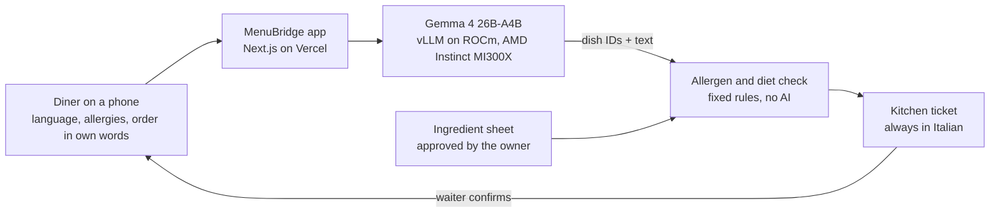

# MenuBridge

**Order in your language. The kitchen gets it in theirs.**

MenuBridge is a QR menu that rewrites itself for each diner. A tourist scans the code at the table, picks a language and any allergies or diet, and reads a menu written for them: what each dish is, how it is eaten, why Romans care. They order in their own words, typed or spoken. Any dish that clashes with their allergies or diet is removed by fixed rules built from the restaurant's own ingredient sheet, with the reason in their language and safe alternatives. The kitchen gets a clean ticket in Italian, and a waiter confirms it at the table. Gemma 4 does all the language work on an AMD Instinct MI300X; it never decides what is safe.

Built for the AMD Developer Hackathon ACT III (lablab.ai), track **Create a New Kind of Experience**.

## Demo

- Live demo: **https://menubridge-nine.vercel.app** (mock answers until the GPU droplet is connected)
- Video: **[add the video link]**
- Try it: `/m/demo-trattoria?lang=ja&aud=first_timer` (Japanese first-timer), `/m/demo-trattoria?lang=en&aud=dietary&allergens=fish` (fish allergy), `/kitchen`, `/demo` (phone and kitchen side by side), `/metrics` (AMD panel), `/about` (how it works and track compliance).

## How it works



The model writes and translates; fixed rules decide what is safe:

- **Gemma 4 generates** dish names and explanations in 8 languages for 4 audiences, the mapping from free text to dish IDs, constraints the diner mentions (which only add restrictions), and Italian translations of notes for the kitchen.
- **It never decides** which allergens a dish contains, whether it fits a diet, or what reaches the kitchen. `lib/gate.ts` computes that from the menu JSON, and checks every line again before a ticket is built.
- **Quality control**: JSON-schema enums of the menu's own dish and ingredient IDs, zod validation with one retry and a safe fallback, a claim guard that rejects "gluten-free"/"safe for"/"vegan" in 8 languages, owner approval per dish, waiter confirmation, and an "AI-generated" label on every AI text.

## AMD usage

- **Model**: `google/gemma-4-26B-A4B-it`, a mixture of experts with about 4B active parameters, so it is fast and fits on one GPU.
- **Serving**: vLLM (`vllm/vllm-openai-rocm:gemma4`) on one AMD Instinct MI300X (192 GB) on AMD Developer Cloud, OpenAI-compatible API with JSON-schema constrained output.
- **Observability**: every model call returns its model, latency, tokens, tokens/s and cost in EUR; vLLM's Prometheus metrics (running and waiting requests, KV cache, tokens) are live in the AMD panel at `/metrics`.
- **Benchmark** (`npm run bench`, realistic MenuBridge requests at 1, 8, 32 and 64 concurrent requests):

<!-- bench:start -->
Not run yet. `npm run bench` against the droplet writes this table, `bench/results.json` and `bench/results.md`.
<!-- bench:end -->

## Run locally

Mock mode needs no GPU:

```bash
npm install && cp .env.example .env.local
npm run dev        # http://localhost:3000, MOCK_LLM=1
```

Against the model: in `.env.local` set `MOCK_LLM=0`, `LLM_BASE_URL`, `LLM_API_KEY` and `LLM_METRICS_URL`. With Docker: `cp .env.example .env && docker compose up --build`.

| Command | What it does |
|---|---|
| `npm test` | Unit tests (vitest), including the allergen gate |
| `npm run bench` | Load test of the live endpoint; writes `bench/` and the table above |
| `npm run warm-cache` | Saves the live model's answers for the demo into `data/cache` |
| `npm run smoke -- <url>` | Checks a deployment: pages, health, a menu, an order with a removal |
| `npm run check-submission` | Checks the lablab texts in `submission/` against their limits |
| `npm run screenshots -- <url>` | Writes the QR code and the slide images to `submission/assets` (set `CHROMIUM_PATH`, or have Google Chrome installed) |

## Environment variables

| Variable | Example | Meaning |
|---|---|---|
| `LLM_BASE_URL` | `http://DROPLET_IP:8000/v1` | OpenAI-compatible endpoint: vLLM on the MI300X droplet (or AMD Token Factory) |
| `LLM_API_KEY` | secret | The `--api-key` given to vLLM |
| `LLM_MODEL` | `google/gemma-4-26B-A4B-it` | Model name the endpoint serves |
| `LLM_METRICS_URL` | `http://DROPLET_IP:8000/metrics` | vLLM Prometheus metrics for the AMD panel |
| `GPU_HOURLY_USD` | `1.99` | Droplet price per hour, from the billing page |
| `EUR_PER_USD` | `0.86` | Exchange rate for costs in EUR |
| `BENCH_TOKENS_PER_SEC` | printed by `npm run bench` | Throughput at concurrency 32, used to price each call |
| `ADMIN_PASSCODE` | secret | Unlocks `/admin/import`; the page is closed when unset |
| `MOCK_LLM` | `1` | `1` = canned answers, no model needed |
| `CACHE_WRITE` | unset | Set only by `npm run warm-cache` |

## Deploy

1. Start the model on the droplet (vLLM with `--api-key`), and open only port 8000 in its firewall.
2. Import this repository in Vercel and set the environment variables above, with `MOCK_LLM=0`.
3. Run `npm run bench` and `npm run warm-cache` against the droplet, commit `bench/` and `data/cache`, and set `BENCH_TOKENS_PER_SEC`.
4. Deploy, then run `npm run smoke -- https://menubridge-nine.vercel.app`.
5. When the GPU is switched off, the app serves the saved answers with the banner "GPU offline - showing results generated earlier on AMD Instinct MI300X".

To add a restaurant: open `/admin/import`, paste its Italian menu, check the draft with the owner, download the JSON, commit it as `data/<id>.json`; the menu is then at `/m/<id>`.

## Track compliance

`/about` is the compliance statement: what is created (a personal menu, an order, an Italian kitchen ticket), what the model generates and what it never decides, quality control with live counters, cost per experience from the benchmark, who pays (the restaurant's monthly subscription) and the AMD stack.

## Limitations

- The demo menu uses typical Roman recipes, not a real restaurant's ingredient sheet; each restaurant approves its own.
- Orders and tickets live in the browser (BroadcastChannel and localStorage), so the diner and the kitchen must share a browser; a real deployment needs a server-side order store.
- Ingredient names in reasons are in Italian or English; the UI translations into Japanese, Chinese and Russian still need a native speaker's review.
- Saved demo answers are only used for exactly the demo texts and profiles; anything else needs the live model.
- Voice input depends on the browser's Web Speech API.
- Costs charge every token at the measured output rate, so they are an upper bound.

## Licence

MIT, see [LICENSE](LICENSE).
