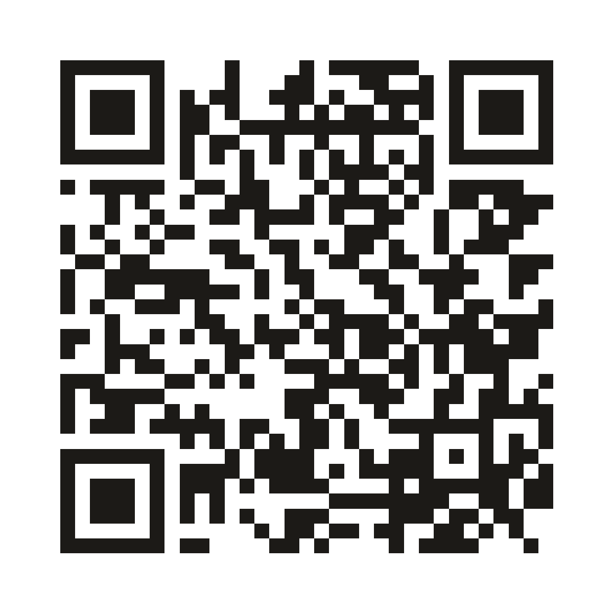
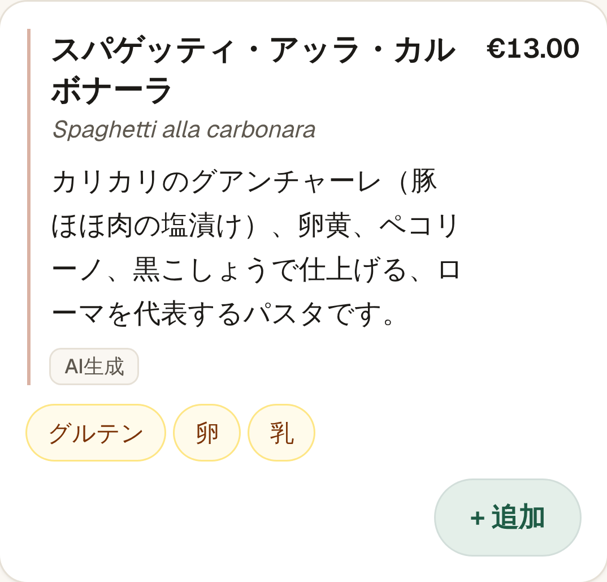
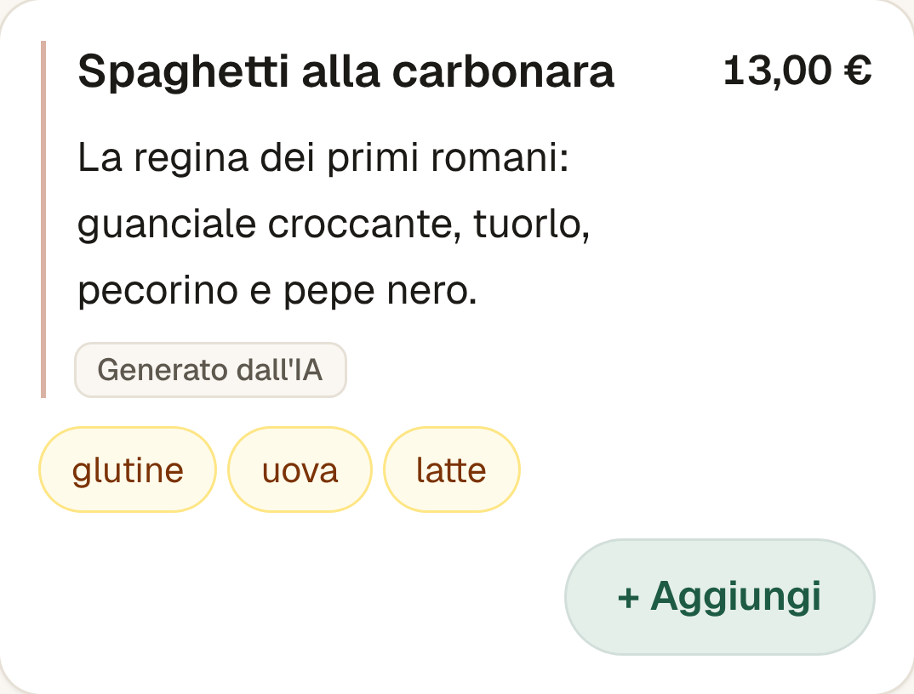

# MenuBridge slides

Ten slides. Fill in your name and the video link on slide 10 before exporting to PDF; `npm run check-submission` lists them. The images are in `assets/`, taken from the demo running on canned answers (`MOCK_LLM=1`); retake them with `npm run screenshots -- <url>` once a GPU is connected.

## 1. MenuBridge

Order in your language. The kitchen gets it in theirs.

 · https://menubridge-nine.vercel.app

> Speaker notes: MenuBridge is a QR menu that rewrites itself for each diner and sends the kitchen a ticket in Italian. The demo you will see runs on saved canned answers: it is built for Gemma 4 on one AMD Instinct MI300X, and no GPU was connected in time.

## 2. The problem

- Rome had 22.9 million tourist arrivals in 2025.
- The menu is in Italian; most visitors can't read it.
- Anyone with an allergy trusts a rushed translation or a busy waiter.
- Staff spend minutes per foreign table explaining dishes, and mistakes reach the kitchen.

> Speaker notes: This isn't a translation problem. A translated menu still doesn't tell a Japanese family what cacio e pepe is, and it can't promise anything about allergens.

## 3. One dish, two diners

 · 

The menu is written for the person holding it: a first-timer gets what it is and how to eat it; a food lover gets origin, technique and the detail Romans argue about.

> Speaker notes: Same dish, same ingredient sheet, two experiences. The model writes the words; nothing about safety changes between them.

## 4. How it works

Diagram: diner → app → Gemma 4 on MI300X → allergen and diet check (fixed rules) → Italian kitchen ticket; the ingredient sheet feeds the check.

After the order, **My meals** keeps a private record on the phone of every dish, its ingredients and allergens, for a doctor.

> Speaker notes: The diner orders in their own words. Gemma maps that to dish IDs and translates notes; then deterministic code checks every dish against the owner-approved ingredient sheet before anything reaches the kitchen. My meals is built from the same sheet, never from the model: dish, ingredients and allergens in the diner's language and in Italian, so someone with an allergy or coeliac disease can show a doctor exactly what they ate. It says it is not medical advice.

## 5. What the AI does, and never does

| Gemma 4 does | It never decides |
|---|---|
| Explains dishes in 8 languages for 4 audiences | Which allergens a dish contains |
| Maps "something Roman, no pork" to dish IDs | Whether a dish fits a diet |
| Translates notes into Italian for the kitchen | Whether a dish is safe |
| Drafts a new restaurant's ingredient sheet for the owner to approve | What reaches the kitchen |

> Speaker notes: Allergens come from fixed rules over the restaurant's own sheet. The model can only name dishes that exist, every answer is validated, and a claim guard rejects "gluten-free" or "safe for" in 8 languages.

## 6. Built on AMD

- Built for Gemma 4 26B-A4B (mixture of experts, about 4B active parameters) on one AMD Instinct MI300X, 192 GB
- vLLM on ROCm, OpenAI-compatible endpoint with JSON-schema constrained output; connecting it takes three env vars
- The AMD panel (`/metrics` and the drawer) shows model, latency, tokens/s and cost for every call; with canned answers it shows "mock"
- `npm run bench` (1, 8, 32 and 64 concurrent requests) and `npm run warm-cache` are ready; they were not run because no GPU was connected in time, so there are no benchmark numbers yet

> Speaker notes: This slide has no measured numbers on purpose. The AMD Developer Cloud MI300X server was not set up in time and the Token Factory key was rejected, so the demo runs on canned answers. Everything that talks to the GPU is built and waiting: point the three env vars at vLLM, run the benchmark, and the panel measures every call.

## 7. Track compliance

- **Created:** a personal menu, an order, an Italian kitchen ticket
- **Model generates:** explanations, dish mapping, translated notes
- **Quality control:** fixed-rule gate, dish-ID enums, zod validation, claim guard, owner approval, waiter confirmation, AI labels
- **Cost per experience:** measured per call in the AMD panel once a GPU is connected
- **Who pays:** the restaurant, monthly subscription

> Speaker notes: All of this is also on the About page of the demo app. The cost per diner will come from the AMD panel once a GPU is connected; we show no number until it is measured.

## 8. Business and pilot

- The restaurant pays a monthly subscription; we will test €29 a month with the pilot.
- Measurable gain: staff minutes per foreign table, order mistakes, allergen questions answered without staff.
- We are looking for a pilot trattoria in Rome.

> Speaker notes: We have no pilot yet. We are based in Rome and are looking for a pilot trattoria there, to measure staff minutes per foreign table and order mistakes before and after MenuBridge.

## 9. Roadmap

- Till (POS) integration, so tickets go straight to the kitchen printer
- Payments at the table
- More cities and cuisines, owner-run menu import
- Export My meals as a PDF for a doctor
- IMMENT incubation: incubation would fund the first paid pilots in Rome

> Speaker notes: The menu import is built: paste a printed menu, the model drafts the ingredient sheet, the owner approves it, and the restaurant is ready. Like the rest of the demo, it runs on canned answers until a GPU is connected.

## 10. Thanks

[[Your name]] · https://menubridge-nine.vercel.app · github.com/feedddosever/amdgimmemyaccess · [[video link]]

> Speaker notes: Try it now: scan the QR code on the first slide and order something Roman.
